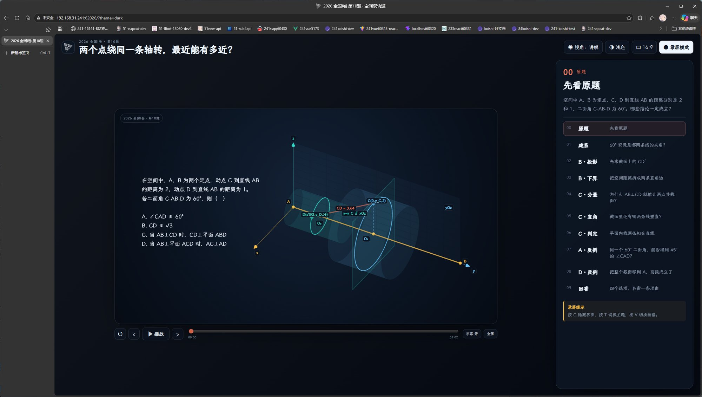

# 2026 全国I卷 第10题 · 空间双轨道

> 网页互动与 OBS 录屏用 Three.js 动画。已配备开源 Whisper 自动提取与高颜值霞鹜文楷中文字幕。



## 题目与答案

- 题源：2026 年全国 I 卷第 10 题
- 正确答案：BC
- 核心结论：\(CD\) 的最小值为 \(\sqrt3\)；当 \(AB\perp CD\) 时，可推出 \(CD\perp\) 平面 \(ABD\)
- 建系：以 A 为原点，\(AB\) 所在直线为 \(y\) 轴（从 A 指向 B），\(z\) 轴竖直向上，\(x\) 轴按图示垂直于 \(AB\)

## 启动

```powershell
npm install
npm run dev
```

默认地址：<http://127.0.0.1:62026/>

## 交互与录屏

控制方式与另外两个项目一致：`Space` 播放，方向键切换步骤，`T` 切换主题，`V` 切换画幅，`M` 切换讲解/自由视角，`Home` 或双击复位镜头，`C` 进入录屏模式。两种视角都支持左键旋转、右键平移、滚轮缩放。

横屏：

```text
http://127.0.0.1:62026/?mode=capture&theme=dark&ratio=16x9
```

竖屏：

```text
http://127.0.0.1:62026/?mode=capture&theme=dark&ratio=9x16
```

可附加 `&step=3`、`&captions=0`、`&autoplay=1`。

附加 `&camera=free` 可让步骤切换不再自动转动相机，适合边讲边自由观察。

全片 10 幕，共 2 分 02 秒：`00` 原题、`01` 建系、`02–03` B（投影与取等）、`04–06` C（向量分量、截面直角、线面判定）、`07` A 的 45° 反例、`08` D 的点积反例、`09` 四项回看。

## 文件

- `src/scenes/scene.ts`：两条圆轨道及圆心 O₁、O₂ 标注、动点、平面 ABD 和二维俯视插图
- `src/scenes/dihedralMath.ts`：点坐标、径向距离与最小距离
- `src/main.ts`：十幕脚本、分段字幕与公式；`src/scenes/proofDrawing.ts`：投影、角弧和直角等证明辅助图形
- `content/`：题面、分镜和人工配音提示

## 验收

```powershell
npm run typecheck
npm test
npm run build
```
